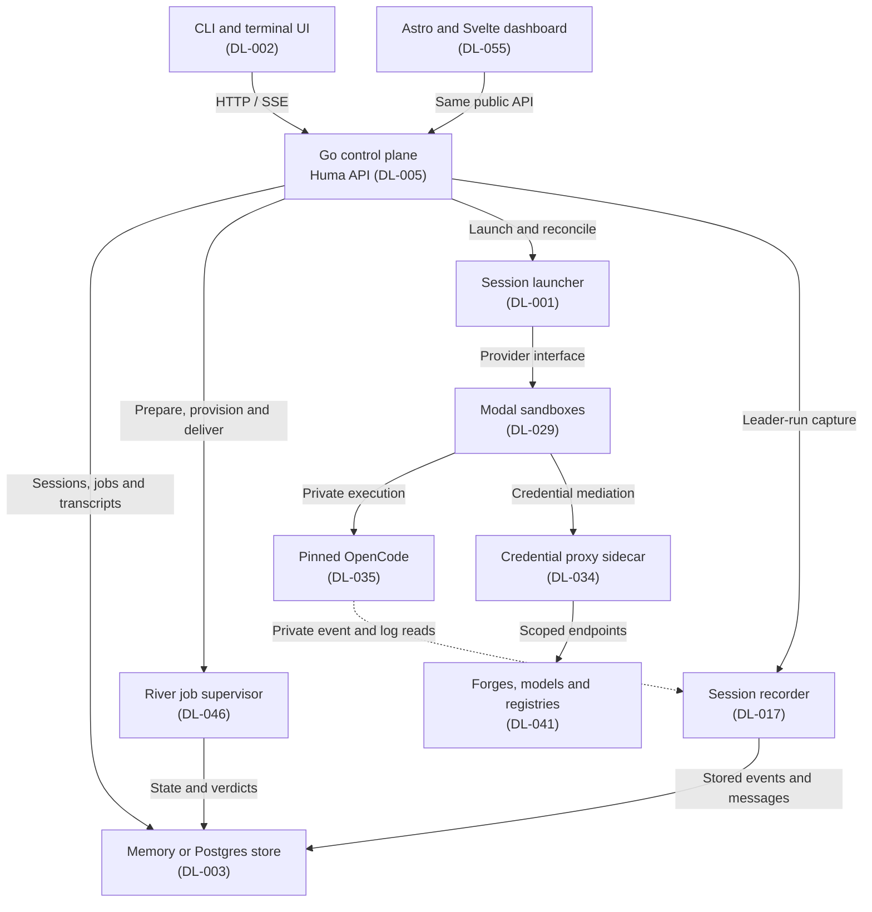
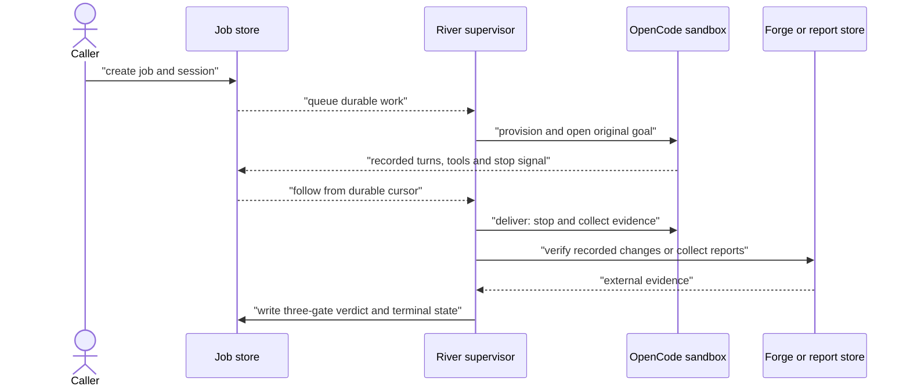
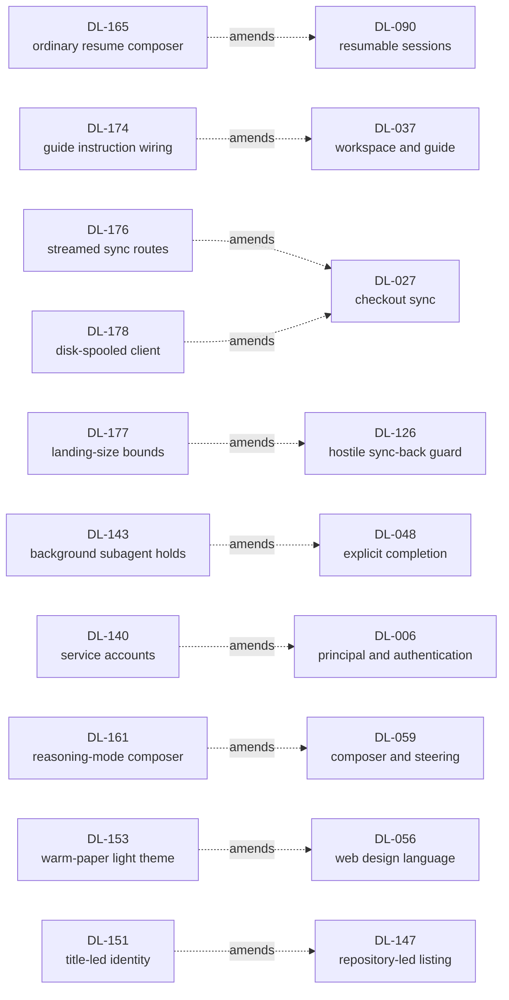

# System Overview

> Auto-generated narrative synthesis from 178 active decisions and 0 proposed decisions. Last updated 2026-11-22.
> This document is derived from individual decision records — do not edit manually.
> Use `/dld-snapshot` to regenerate.

## Architecture Overview

spov turns local repositories and unattended goals into isolated OpenCode sessions without making a developer's machine host the agent or its secrets. The same Go control plane serves terminal and browser clients, owns durable session/job state, launches bounded Modal sandboxes, records their work and verifies declared outcomes. Ordinary interactive workflows preserve local checkout state through defensive sync-back; autonomous workflows deliver pull requests, reports or an apply-able repository snapshot.

The central constraint is separation of responsibility: clients never drive Modal directly, read paths never keep a sandbox alive, the agent's environment holds no usable forge or provider credential in the standard deployment, and durable store records—not agent narration—drive recovery and verdicts (DL-001, DL-002, DL-018, DL-034, DL-050).

The architecture deliberately allows a local deployment to be little more than this same binary spawning an idle child and journalling its memory store, while a hosted deployment adds Postgres, multi-replica leadership, browser/device authentication and a signed container distribution. Session launch, recording, reconciliation, delivery and sync all operate against the same run and ownership invariants (DL-002, DL-003, DL-004, DL-010, DL-091).

## Server: one durable control plane

spov ships one Go binary containing the terminal client and `spov serve`, with Modal confined behind an internal provider boundary. Sharing the launch, store and reconciliation code is what lets a temporary local child and a multi-replica hosted deployment behave alike; package walls keep the CLI and other clients away from provider internals (DL-001). Both the CLI and browser speak HTTP. Huma on the standard-library mux derives the versioned OpenAPI contract from Go types, generated TypeScript keeps the browser aligned, and typed SSE streams carry progress and logs rather than direct sandbox access (DL-002, DL-005).

### State, identity and deployment

The store is the portable source of truth. A common contract covers the in-memory implementation used locally and Postgres used hosted, including organisation scoping, stable identifiers, cancellation and recoverable provider handles, so a request need not return to the replica that launched its session (DL-003). A leader-locked reconciler lists tagged sandboxes, adopts recoverable work, revives listing inconsistencies, finishes abandoned launches and reaps expiry while leaving supervised job provisioning alone (DL-004). Connect-token budgets are exact across replicas because minting locks the session row before counting and insertion (DL-065).

Authentication resolves every request to one principal through local bearer state, hosted browser cookies, hashed personal-access tokens or the deployment's break-glass token. Ownership checks hide another user's resources, browser-origin protection runs on every listener, and the hosted device flow requires an authenticated human to approve CLI tokens (DL-006). GitHub OAuth login is gated by a live allowlist, which is also the authority for administrators and last-admin protection (DL-007). Secrets follow the server's storage model: the OS keyring locally, or authenticated encrypted rows bound to organisation, owner and purpose hosted. APIs reveal presence and verification facts rather than values, and an unreadable row never triggers a weaker fallback (DL-008).

Local mode reuses a configured hosted server when present; otherwise it spawns an exact-build local child, performs initial reconciliation before readiness and exits when idle. Later commands can rediscover sandboxes and sessions that outlived that child, and the listener is unconditionally loopback-only regardless of `--listen` (DL-002, DL-064). Hosted operation packages the static server and real web application behind one public origin, with environment-based database, authentication, sealing and deployment-owned Modal configuration. Explicit migrations, readiness that checks migration head, and recoverable launch state make rollout and drain safe (DL-010).

### Capacity, models and credentials

Per-user creation limits are enforced before billable work, with independent session and unfinished-job quotas, duration/resource ceilings and transactional owner locks. Job-owned sessions spend the job allowance rather than starving interactive capacity (DL-009); the standard defaults are five independent sessions and four unfinished jobs (DL-162). Newest-first history uses stable ID cursors, while first pages and live streams always include every live session or unfinished job so old billable work cannot disappear behind pagination (DL-012). A closed OpenTelemetry catalogue records only low-cardinality operational data; exporters are opt-in, outcome counters follow winning store transitions, and deployment-wide gauges come from the reconciler leader rather than each scrape (DL-011).

Model providers and credential routes are a static catalogue, while available models refresh from the models.dev/OpenCode mirror with cached and embedded fallbacks. Creation resolves `provider/model[#variant]` from request, user default or OpenCode default and rejects unusable choices before spending money; supported custom models can launch visibly declared when no catalogue entry exists (DL-013, DL-014). Runtime model changes are authorised per-act writes, not config drift in the browser (DL-014).

OpenCode Console grants are refreshed only at launch under a per-user lock and re-read, because rotation invalidates the previous token. New generations are stored before use and pushed to the credential proxy; sandboxes themselves hold placeholders (DL-015). GitHub App tokens follow a separate activity-gated renewal pass that retains the recorded tier and access scope, installs replacements through the recorded holder and revokes old tokens only after successful installation (DL-021).

Published images have their own registry because a deleted Modal image name can still resolve. Exact add-on variants are preferred, recorded alternatives can boot while a replacement builds, and retention-aware pruning protects live and current images. Shared hosted builds have separate per-owner concurrency and daily creation limits, whereas local builds are unconstrained (DL-016, DL-134).

### Recording without billing read paths

A leader-run recorder captures each running session whether or not anyone watches. It subscribes before catch-up, reads positions and messages, stores idempotent events and conversation data, and marks only a real durable-sequence skip as a gap. Redial and storage limits make abandonment visible without turning a dead endpoint into an idle-clock reset (DL-017). Message catch-up pages newest first and stops on a short, missing-cursor or unchanged page, avoiding an assumption that OpenCode returns all history in one response (DL-069).

Browser and API reads answer from those stored rows. State streams fingerprint store snapshots, logs replay and resume by stored cursors, and transcripts are bounded owner-authorised projections. This is a cost rule as well as an architectural one: ordinary sandbox HTTP and exec calls reset Modal's idle clock, so only deliberate lifecycle operations, job-end collection and human writes may touch it (DL-018). Indexed memory reads and journaled undo keep long sessions from degenerating into full-history scans; transcript and log responses alone use streaming gzip with event-by-event flushing (DL-071).

Human messages are server-mediated writes with ownership, state, conversation and identifier validation. Their default `steer` delivery reaches the next agent step, while queue delivery waits for the turn; stored inbox frames support status, echo reconciliation and cancellation (DL-019). Pending permissions and forms are likewise derived from retained events. Replies address only a stored ask, allow once or reject rather than granting persistent access, and release a blocked job only when no other request remains (DL-020).

The cross-cutting behaviour is verified in complementary layers: integration scenarios use production server wiring with real Postgres and controlled sandboxes/forges, browser journeys exercise the real stack, and short real-forge checks cover the remaining external assumptions. Every scenario criterion records which layer owns it, including restart-safe delivery, credential tiers, gates and the rule that views and metrics do not prolong sandboxes (DL-022).

### Releases and operator-facing deployment

A tag produces inspected GoReleaser archives whose checksums are keylessly signed and whose provenance is attested. The release refuses a binary with either web or credential-proxy placeholders, preventing an artefact that would silently change the credential boundary (DL-079). That guard matters at runtime too: a server without the proxy refuses a launch carrying routed credentials instead of placing their secrets in the main container, while API and session views expose only route metadata (DL-077). Releases also publish signed multi-architecture server images, with digest-pinned examples for deployment and source builds retained for unreleased development (DL-082).

The deployment guides lead with those prebuilt artifacts and a shipped user-file shape rather than requiring every operator to compile the project. They cover personal-credential operation, platform declarations, OAuth scopes, migrations and spov's own CLI device-authorization server (DL-105). Long archive responses impose explicit ingress requirements: no response buffering, timeouts that outlast the transfer, live-view heartbeat tolerance and enough request capacity for launch bundles (DL-176).

### Resumable sessions and durable local history

Each sandbox of a session is a run with its own image, pin, lifecycle and snapshot state. Stop ends the current run atomically; usage, connection caches, displayed lifetime and recorder retry budgets follow runs, and asynchronous exit-snapshot collection survives server restart (DL-085). Operators control enablement, age and per-user retention. Daily pruning marks before deletion, protects current work and never lets a pruned snapshot boot again (DL-086).

Resume conditionally reopens a stopped interactive session on the same row with a new run and a quota slot, while excluding jobs. It preserves the recorded repositories, model, network, add-on, environment, access, landing and routed choices, freshly resolving credentials rather than recovering secrets. When no eligible snapshot exists, a transcript resume boots a fresh clone and imports stored conversations with sequence bases that keep the old log coherent; individual import problems are notes rather than destruction of visible history (DL-087, DL-089).

A synced transcript resume can carry the local base as a one-use bundle when the matching checkout still has it. A remote-backed session otherwise falls back to the default branch with a warning, while a local-only session refuses a resume it cannot seed. Subsequent sync-back uses the fallback branch whenever sandbox history no longer descends from the local head (DL-098).

Local persistence uses the same memory store with a journal, not a second database. Session metadata is atomically replaced and transcript records append beneath the per-session data directory; replay resolves last record wins, repairs a torn tail and compacts superseded records (DL-091, DL-092). Configurable startup pruning removes old stopped history only when no kept snapshot still needs it (DL-093).

For large sync results, dedicated routes stream a tar of measured metadata, keep-alives, a bundle and worktree archive followed by a mandatory end record. The server retains only a copy buffer. Refusals before the first byte remain normal API errors; later failure breaks the response so truncation cannot look complete, and abandoned sandbox-side packers are cleaned up. Older JSON exports remain temporarily with their smaller bound for compatibility (DL-176).

### Conversation identity and live model detail

The recorder records each conversation's parent from OpenCode before committing its frames. `store.Primary`—the oldest root conversation—defines the person's main thread for unnamed sends, attaches, job goals and resumes, so a child prompt can never be mistaken for human intent (DL-109, DL-110). Session previews follow the newest nonblank root `user` or `assistant` text rather than a subagent, tool-only event or spov synthetic (DL-115, DL-148). Titles come from that primary conversation or, when absent, the job title; rename events update list decoration stamps, and cleaned single-line titles are labels, never identifiers (DL-149).

Reasoning variants are discovered from the current sandbox's own OpenCode model endpoint once per run under bounded asynchronous reads, then stored against that sandbox (DL-159). A tenant-scoped API serves those stored modes without a sandbox request. Runtime switches accept `#variant` only when this list offers it; launch-time variants cannot be checked that way because their sandbox does not yet exist (DL-160).

### Routed credentials, templates and ordinary environment

Personal routed secrets are sealed with their canonical route hosted, or split between the keyring and an atomic route index locally, allowing a launch to enumerate them without weakening secrecy (DL-073). Administrators manage a separate organisation tier under organisation-specific authenticated data and audit records; members see names and routes but not values, and personal records take precedence within the launch's policy (DL-074).

Attachment defaults to eligible `always` credentials, an explicit launch list is exact, and configuration can only narrow the default; jobs have their own narrowing. The session stores the resolved secret-free selection so resume and sidecar recreation preserve its tier and route decisions, omitting removed or rerouted entries rather than substituting another identity (DL-075, DL-077).

Sandbox templates are personal named collections of launch settings, written through the same server-side validation and stored in Postgres or a local file without repositories, models or secrets (DL-119). Applying one precedes ordinary defaults: the request wins, then the template, then profile/server defaults. Maps merge by name, add-ons and apt travel together, and the resolved snapshot is stored on the session so later runs never reread a mutable template (DL-120).

`sandbox.env` and `--env` handle intentionally non-secret text variables for both interactive work and jobs. Server values form the base, YAML scalars must remain textual, and resolved values are stored and displayed before being set again on resume. Anything that should be hidden belongs in a routed credential instead (DL-096).

### Account security and bounded operation

Browser-session rows contain hashes of high-entropy cookie tokens, and iteration-aware revocation deletes by the stored key rather than hashing it again (DL-127). Allowlist entries name either an email address or a GitHub account. Account entries and user identities bind to GitHub's immutable numeric ID, while logins remain refreshable labels and `id:<github_id>` is the unambiguous escape from stale names. Careful legacy-row binding, multi-entry coverage and self/last-admin checks prevent an account from inheriting another person's history or tokens (DL-128).

Removing a person's final covering entry performs retryable offboarding: browser sessions end, unfinished jobs are cancelled, live sandboxes including held sync work are terminated, CLI tokens are revoked and stored credentials disappear. Every cleanup step is attempted even after another fails, while history, reports, snapshots and secret-free templates remain (DL-132).

Service accounts extend ordinary ownership and quotas to CI without admitting a new kind of person. They use reserved non-email addresses, cannot sign in or administer, and authenticate only while enabled through bearer tokens; deletion permanently disables the row and invokes offboarding with the same quota-lock ordering used by creates (DL-140). Admins issue and revoke their hashed, once-revealed tokens under account and token caps. An issuing admin's departure does not break pipelines by revoking these tokens, but the resulting audit names what should be rotated; deleting the service account does revoke them (DL-141).

Request limits are fixed per replica and separated by class: sign-in/device endpoints use address and network buckets plus bounded in-progress attempts, while authenticated users have independent rate, create, stream and in-flight budgets. Browser-guard refusals spend nothing, forwarded addresses count only through configured trusted proxies, body routes have read deadlines suited to their sizes, and clients respect `Retry-After` (DL-133). Repository-listing cache entries are short-lived per organisation, user, tier and replica; failures are not cached and credential actions invalidate the appropriate entries, while security-critical launch and gate checks bypass it (DL-134).

Stored history has hard ceilings on conversations, records and bytes. Recording stops at those limits without stopping the sandbox or spov's own lifecycle markers, and readers use bounded newest tails except during deliberate transcript import (DL-131). A final hardening cluster tightens origin/scheme matching, Secure cookies, shared-token strength and generic store-error responses; scrubs encoded credentials and hostile proxy requests; validates outgoing links and report archive names; contains background panics; and requires caller deadlines around every sandbox exec (DL-135).

## CLI: the local, scriptable control surface

The command tree puts session lifecycle verbs at the top level—`fly`, `attach`, `ls`, `stop`—and autonomous work under `jobs`. `stop`, `interrupt` and `cancel` deliberately name different acts, and `--json` emits the decoded API view alone while guidance goes to stderr. Completion queries only an already-running compatible server, never starts infrastructure as a side effect, and fails quietly within a short bound (DL-023). The launch view shows observable stages and durations, using an alternate terminal screen only where that is safe and closing it before progress, errors or OpenCode's TUI take over; `--plain` and pipes retain simple output (DL-024). `attach` waits through store-backed reads until a session can be joined, selects its primary conversation and leaves the underlying session or job alone when a wait is interrupted (DL-025).

Repository selection combines all configured platforms in one fuzzy picker, preserving repository identity across reranking and tolerating partial platform failures. Hosted choices reflect the actual credential tier of the coming launch rather than a repository that only another tier can reach (DL-028, DL-042).

Configuration has an explicit user/project/environment precedence, visible errors for unknown schemas, and a trust boundary around shared checkouts. A project file cannot select a server or define platforms, because either could redirect credentials; the server itself never reads that file. Launch choices travel in validated requests rather than changing a spawned server's environment (DL-026). Template names are stricter still because templates can attach `asked` credentials: they come from flags or user configuration, never a cloned project, and once selected only explicit flags override template-covered settings. The `templates` group lists, shows and removes their server records with the same JSON discipline (DL-122).

### Checkout sync without trusting the export

A synced launch starts from a clean attached local branch, bundling unpushed history when necessary, and brings back both commits and working-tree edits. In-place application happens only when the checkout has not diverged; otherwise the result becomes `spov/<session>`. Export precedes termination, so a failed round trip leaves the remote work available instead of silently deleting its only copy, and a checkout with no usable remote can operate bundle-only (DL-027). Several matching platforms are an error rather than an excuse for an unsafe downgrade; automatic checkout sync is the default for a plain `fly`, but any unmet precondition refuses the launch instead of quietly proceeding unsynced (DL-066, DL-095).

The returned export is treated as hostile input from a root-capable sandbox. Before a local write, the guard compares committed and archived changes against the checkout as Git sees it, refusing or moving to the fallback branch when work would touch ignored/untracked content, hooks, configuration, `.git` aliases, path-aliased names or submodules. Bundle integrity and expansion bounds are checked before landing, and commits fast-forward without overwriting ignored files (DL-126). All spov-started Git processes pass through one constructor that neutralises hooks, filesystem monitor, pager, prompting and external diff while forcing platform `.git` protections. The CLI then reports branch, commit range and changed paths, and sanitises agent-controlled terminal text without corrupting pipe-oriented JSON or raw reports (DL-136).

Archive transport uses landing-relevant bounds measured before packing: bounded total content, individual files and changed-file counts, with a still-smaller launch seed (DL-177). The CLI streams the response into a private spool beneath the checkout's Git common directory rather than RAM, validates its declared regular-file layout and sizes, and requires the end record and matching measurements before reading the bundle and worktree incrementally through the same safety guard. Cancelling a download removes the spool; once local mutation starts, landing is allowed to finish rather than leaving half-applied state. A legacy server is recognised narrowly and falls back to the bounded JSON export (DL-178).

### Installation and first-run readiness

Release-supplied `install.sh` detects supported systems, verifies checksums before unpacking, optionally enforces signature verification and installs without sudo. It can fetch the exact integrity-checked OpenCode package as well, making re-running the script the update mechanism instead of adding an updater to the binary (DL-080). Homebrew metadata is generated from those same versioned archives without coupling release success to the tap upload (DL-081). Strict version-string validation and explicit terminal-safe output prevent installer redirects, server pins or agent text from becoming path or terminal injection (DL-136).

Documentation leads new users through install, `spov init` and `spov fly`, keeping source builds and detailed engineering material elsewhere (DL-099, DL-125). Init is a repeatable capability checklist for Modal, forge access, a model, the local OpenCode client and the published image. Read-only checks never modify configuration, while interactive fixes act only for missing steps after an affirmative answer and call the same operations as their underlying commands (DL-123, DL-124). User-file edits are conservative and rolled back if they no longer parse; model input is not echoed, and a local server with live sessions is not restarted just to see new keys (DL-124).

A separate opt-in can use the local `gh` login through a stored marker, not a copied token. Each launch asks `gh` for its current token so logout and re-login retain their normal meaning; the option never applies to a hosted server, and a failed lookup does not silently choose another identity (DL-083, DL-124). Init's presentation adds colour only on a capable terminal and keeps exactly the same sanitised, wrapped words in plain output (DL-152).

### Orchestration and return trips

`jobs wait` polls the store until a terminal outcome and maps success, partial delivery, failure, cancellation and operational interruption to distinct exit codes. Waiting does not own the job: a timeout or Ctrl-C leaves it running, and create-plus-wait JSON emits the created view before the final view so an orchestrator always has the ID (DL-103). A synced session resumed from its matching checkout syncs back on exit before stopping; elsewhere it remains running with instructions for a deliberate later apply or discard. Snapshot resume never reapplies the original seed over later sandbox commits (DL-104, DL-095).

## Git: forge abstraction and least-privilege access

One internal platform interface covers GitHub, Forgejo, Gitea and GitLab without erasing their difference. Forgejo and Gitea share an adapter, GitLab has its own REST client and exhaustive kind handling gives an unknown kind no accidental GitHub behaviour. Repository paths retain complete owner namespaces—including nested GitLab groups—and clone URLs never contain credentials. Stored tokens are inspected before saving where the forge supports it, and support claims follow a tested real-forge matrix rather than API similarity alone (DL-041).

Each hosted launch resolves a personal or organisation credential tier, records that choice and uses it consistently for renewal, sidecar recreation, access checks and verdict queries. A missing preferred tier may fall back; an unreadable credential may not become another identity. Organisation GitHub Apps are environment-defined or admin-checked and sealed separately, while repository listings distinguish which tiers can reach each result (DL-042).

Access defaults to the session's selected repositories. `all` broadens credentials to the caller's available platforms but does not remove stored-token endpoint policy, and deployment-owned credentials require explicit administrator consent. Jobs have an independent default; selected-repository reachability is checked before launch, and views describe credential kind, tier, holder and scope without secrets (DL-043).

Git authorship is resolved separately from authentication from flags, spov and Git configuration, profiles and deployment defaults, then written into the sandbox. Missing identity warns without disabling read-oriented work, while malformed Git configuration is not mistaken for absence (DL-044). Forge credentials can additionally read package registries only through bounded read-only routes and session-selected namespaces when that forge/token combination supports it; widening git access widens those namespaces but never enables publishing (DL-078).

Sync-export bounds belong to this same access contract. New Git objects and changed content, large individual blobs/files and changed-file counts are measured before export or sync-job verdict so a passing result fits the corresponding landing guard. Refusals identify useful measures and leave the session retrievable; the smaller seed and legacy JSON limits remain separate transport formats rather than hidden expansions of those allowances (DL-177).

## Sandbox: reproducible, bounded ephemeral infrastructure

All Modal SDK use is confined behind `internal/sandbox`'s provider and handle interfaces, with an exact SDK pin and a fake at the package boundary. Creation waits for readiness and cleans up partial failures; hard and idle timeouts bound cost from birth, while ownership, repository, job, proxy and run tags let another server process adopt or terminate the resource. Termination is confirmed because assuming it can leave an invisible bill (DL-029). An invalid Modal environment on a by-name lookup is a configuration error rather than “not found,” preserving the distinction between an absent resource and a broken control plane (DL-067).

OpenCode listens privately; no sandbox port is published. Short-lived, port-bound connect tokens, OpenCode authentication and loopback client proxies provide layered access, while server-side recorder and job clients reuse bounded in-memory connections. Terminating the sandbox is the ultimate token revocation, and deliberately infrequent keepalive activity prevents an attached stream from becoming an unnoticed permanent bill (DL-030).

### Images, add-ons and configuration

The base image name derives from its complete recipe and OpenCode pin. Layers move from stable system and toolchain content to frequently changed add-ons, forge CLIs and OpenCode, allowing recipe cache reuse without mutable launch-time installers. OpenCode and forge CLIs are integrity checked, and operator publication makes the base a known launch artefact rather than an unpredictable registry query (DL-032).

Curated add-ons are the supported extension mechanism. Names and version shapes are parsed before commands exist, partial versions resolve to exact upstream releases, and pinned apt sources verify key fingerprints and repository scope. Both requested and booted selections are recorded; services start before clones and OpenCode, and the generated guide uses the same recipe data as the image (DL-033).

User environment variables are deliberately non-secret and constrained so setup remains deterministic. CLI, API and launcher validation reject names spov computes, sensitive OpenCode authentication or model-list settings, shell/proxy/trust variables, forge credential overrides and prefixes such as `GIT_`, `LD_`, `XDG_` and `MISE_`. This protects bootstrap integrity rather than claiming a security boundary against the sandbox itself (DL-097).

Egress is an explicit policy even when it is `open`, which preserves the ability to narrow a live sandbox. Installation and agent presets enumerate their dependency and service domains, and bounded extra domains from callers or operators join at launch and recreation. Job egress remains open by default because development tools are unpredictable; network policy is not substituted for credential scope or the job wall clock (DL-031, DL-068). Declared interactive OpenCode plugins add npm registry access under the agent preset because they are installed only when the first conversation begins, while repository-only plugins remain the caller's explicit network responsibility (DL-172).

### The credential sidecar and endpoint policy

Forge tokens and provider keys normally live in a separate proxy container, not the agent's main filesystem or environment. That container uses a per-sandbox name-constrained CA to decrypt only approved forge, provider and routed hosts, strips incoming credential headers, applies narrowly selected credentials and scrubs reflected secrets. Main-container clients see placeholders and proxy settings; bypassing the proxy means sending no token, not finding it in an environment variable. Sidecar recreation prefers the retained CA so running clients keep their trust, while repeated proxy failure ends the sandbox (DL-034).

Policy is as important as where the token sits. Stored forge tokens attach only to allowed selected-repository endpoints, and provider keys to their own catalogue hosts and paths. GitHub personal tokens also receive read-only Actions, releases and search to support ordinary inspection without workflow administration (DL-107). GitHub App tokens have broader path coverage but are withheld from REST pull-request merge forms and their encoded or repository-ID aliases; branch protection remains the real merge control because other Git and GraphQL paths exist (DL-139).

Routed credentials generalise this pattern to package registries and other HTTPS services. Each secret has exact hosts, optional path prefixes and a constrained authentication scheme; route hosts join the CA and egress plan, non-route traffic receives no value, and collision/header rules prevent one credential from displacing another or changing HTTP framing (DL-072). npm, Maven, NuGet and PyPI presets supply configurations containing placeholders, while a common Java trust store and JVM proxy configuration let decrypted routes work consistently across JVM tooling (DL-076).

### Bounded output and selective persistence

Ordinary exec operations return bounded stdout and stderr and reject excess rather than presenting truncation as success. Caller-specific bounds do not replace mandatory deadlines, so a malicious or broken helper cannot consume unbounded memory or time (DL-130). Output destined for another client instead uses `ExecStream`: a bounded copy buffer forwards stdout, a total byte cap remains enforceable and stderr stays bounded. Writer failure ends only the read, leaving the caller's deadline as the process-lifetime control; long transfers use separate short execs to maintain Modal activity (DL-175).

Most sandboxes remain ephemeral, but eligible interactive sessions can take an exit snapshot when history persists and the proxy holds every secret. Jobs and proxy-less sessions cannot take one. The snapshot stores the main filesystem—including clones, uncommitted work and OpenCode state—without sidecar files or memory, deliberately extending repository-data retention without preserving forge or provider credentials (DL-084).

## OpenCode: a pinned and contract-checked agent runtime

A deployment has one exact OpenCode version shared by its sandbox image and runtime checks. The sandbox must match exactly, while a local interactive client can tolerate compatible version-part differences without making overrides routine. The server publishes only its pin through an advisory unauthenticated handshake: an older or unreachable server leaves the client on its own configured pin rather than turning compatibility discovery into a launch dependency (DL-035).

Version changes are verified against the pinned build's OpenAPI document, provider-package integrity records and behavioural probes. Fake OpenCode servers validate production request paths and fields, test fixtures check event frames and log items against the document's schemas, and genuinely synthetic cases must be labelled unchecked with a reason. Production recording still tolerates unfamiliar future events instead of deleting history; strict schema enforcement belongs to the test contract (DL-035, DL-145).

### Startup, workspace and interactive plugins

The entrypoint starts add-on services, establishes proxy trust, writes placeholders and forge configuration, performs hardened parallel clones, creates workspace support directories, emits the guide/configuration and finally executes OpenCode in the foreground. Clone arguments cannot become options, every background clone is awaited, and credentials never appear in argv or URLs (DL-036).

`/workspace` is the shared root for multi-repository work, with reserved `/workspace/out` for reports and `/workspace/.scratch` for temporary material. The generated guide tells the agent how the actual repositories and toolchain fit together and to read each repository's own instructions. It also directs a forge 401/403/404 toward a bounded retry and an exact error report—not another login or a request for a replacement token (DL-037, DL-108).

With the credential proxy present, a one-repository interactive session normally starts inside that repository so its own `opencode.json`, `.opencode/` and instructions behave as in a local checkout. Without the proxy, startup-time repository code could reach main-container secrets, so workspace-root landing remains; `landing: .` is the explicit opt-out (DL-170). Repository landing also lists the outer generated guide in OpenCode's global instructions when necessary, because its ordinary instruction search stops at a repository root and would otherwise lose spov's orientation (DL-174).

Interactive configuration supports validated model declarations and bounded npm plugin specifications from configuration, templates or `--plugin`. Those plugins persist in the recorded launch and work with repository plugins, while jobs deliberately discard them because their extra tools fall outside the established per-kind permission model (DL-038, DL-171).

### The job plugin and resumable runtime

A job's import-free plugin is embedded in spov and written at startup, keeping its behaviour tied to the launching server rather than an old base image. It reasserts the original goal through ordinary turns and compaction, continues only through queued synthetic messages and carries repository/deliverable guidance without treating guidance as containment (DL-039). Its per-kind permission allowlist preserves existing denies, protects credential and plugin paths, restricts report writes to their allowed roots, and escalates repeated denials from a note to an explicit stop. Unknown kinds deny everything, but shell/API escape routes mean the sandbox, egress and token scopes remain the actual security boundaries (DL-040).

Completion and pull-request tools observe OpenCode's abort signal. An aborted pull-request call leaves no record. If completion is interrupted during its check, the check group stops and—absent another standing stop—the declaration is withdrawn without a stop marker, leaving a person's interrupt in control. Once the stop marker exists delivery stands; a competing wall-clock or explicit stop wins under its own reason, without rerunning a killed check or fabricating its result (DL-146).

Snapshot resume boots only a kept or awaited snapshot from the newest previously running run and only at the current OpenCode pin. It skips seeding, verifies clone directories, then rebuilds trust stores and rewrites current placeholders, forge/routed configuration, plugin and guidance for the new run before restarting add-on services and OpenCode. An older pin or ineligible run uses transcript resume instead, and a pending or failed snapshot is not silently treated as disposable work (DL-088).

## Jobs: durable unattended execution

A job is a durable control-plane object with a goal, kind, owner, dedicated session, independent quota and explicit state machine, not merely a long-lived agent turn. Creation validates the potentially billable choices and commits the job and its starting session together before queueing work. `queued`, `provisioning`, `running`, `delivering`, `steered`, `blocked`, `succeeded`, `failed` and `cancelled` distinguish new work, active execution, suspension and terminal outcomes; only the supervisor and the deliberate human acts use the transition table, and locked updates prevent a late pass from resurrecting a decided job (DL-045).

The supervisor is a River worker in `internal/jobs`, separated from the HTTP service by function seams. Short, retryable passes follow the recorder's stored events and transactional cursor rather than occupying a worker or polling a sandbox. They recognise turn endings, permission requests, takeovers and stop markers; a recording gap means unknown history, not proof that nothing happened. Sandbox adoption, queue uniqueness, restart sweeps and idempotent delivery make retries safe, while a backstop judges abandoned work only when its session is no longer live—never because a live run has been quiet (DL-045, DL-046, DL-048).

Before provisioning, one bounded control-plane model call can assess the goal, propose a check and produce a short cleaned title. The original goal remains first and verbatim in the opening turn; the assessment is subordinate, and a failed or unrecorded pass never fails the job. A caller's check always outranks a proposal, and a title is display metadata rather than prompt text. Pipeline callers can fix `skip_prep` at creation to suppress this call and its products entirely (DL-047, DL-138, DL-150). For `pr` jobs only, `pr_policy: goal` can leave branch and pull-request flow to the supplied goal while retaining repository restrictions, recording requirements and independent delivery checks (DL-137).

Inside the sandbox, the plugin reasserts the goal and continues with synthetic items; the server remains authoritative for state and recovery. Completion is an explicit structured declaration, with its requested check run before the stop marker, not an assistant saying that it is done. A pending human message defers completion, failed turns have bounded retries, and aborting a completion check can withdraw the declaration when a person interrupts; an abort after the stop marker does not rewrite history (DL-048, DL-146).

The job has one wall-clock allowance across its lifetime. Only `running` and `blocked` spend it, so steering pauses the clock and resuming consumes the remainder. At the bound the supervisor records why and enters delivery, which stops the run before collecting what exists; reaching the limit does not erase valid artefacts, though it normally makes the deliverable result partial (DL-049).

Subagents do not blur human intent. Only the job's root conversation establishes a person's takeover, withdrawal or correction, while child tool calls and unanswered asks still count as job work (DL-114). Background children suppress otherwise pointless parent continuations while active, subject to a bounded wait, and their synthetic reports restart the parent without impersonating a person. Declared completion still ends the run without waiting for outstanding children, so agents must gather any work they need before delivering (DL-143).

### Delivery and independent judgement

A `pr` job records `(repository, branch)` as it opens or updates each selected-repository change; spov then asks the relevant forge using the owner's recorded credential tier and verifies open or merged changes. A `report` job's deliverable is every Markdown file directly in `/workspace/out`, collected whole within documented limits together with safe linked images. Inventory is stored separately from report bodies, retries collect missing content, and outcome-deciding records survive evidence-file truncation (DL-051).

The final verdict combines three gates, not the agent's confidence or an exit code. Gate 1 runs the mechanical check and distinguishes failure from an unverified or unusable command. Gate 2 evaluates the complete deliverable set, with `partial` for verified work accompanied by missing, unverified or unfinished portions. Gate 3 reconstructs conduct from tool parts and permission frames: a wholly refused run or unanswered request vetoes, while a refusal followed by a valid alternative does not. Only passed or partial external delivery can carry success; spov's own inspection failure is `unverified`, never proof of agent failure (DL-050, DL-051).

### Steering and held work

A human message's `after` choice says whether the job continues or hands over, independently of whether the message uses steer or queue delivery. Takeover occurs when a handover is delivered: the plugin holds its continuation loop and the supervisor records `steered`; `continue` neither pauses the run nor releases an existing hold. Interrupt stops the current turn with `resume=true`, making a pending correction readable at once, and only the explicit user-interruption reason holds the loop (DL-052, DL-053). Resume clears that hold, preserves the remaining wall clock and creates a boundary so old messages cannot steer the job again. A blocked run resumes explicitly, or automatically when its final unanswered permission is answered through spov (DL-054).

A `sync` job reuses this machinery for checkout-to-checkout work. Its durable seed comes from the local checkout, it lands inside the selected repository, and delivery stops the run before inspecting commits and working-tree changes. A changed repository within the archive bounds is the deliverable; no change or excess fails, while an unreadable repository is unverified (DL-100, DL-101).

A sync row reaches a terminal verdict but its stopped sandbox is deliberately held for a bounded period so that exact judged state can be exported. Held work still consumes a job slot and cannot be joined or accidentally stopped as an ordinary session. `spov jobs apply` lands the export through the defensive sync-back path and then releases it by default, while `--keep`, an unfinished job or a failed landing preserves the hold. Release is the explicit way to discard held work (DL-101, DL-102).

## Web: an embedded operational interface

The dashboard is a statically built Astro application with Svelte 5 islands and one shared browser data layer over the public HTTP API. It has no independent server-side backend: generated typed API definitions, resource state and cursor-aware SSE wrappers mirror the server's contracts, and the built assets are embedded in the Go binary for distribution (DL-055). The visual language uses bundled Atkinson faces, consistent semantic colours, marks and words rather than colour alone, plain copy and progressive disclosure. Warm-paper light surfaces and AA-contrast themes support dense operational information without turning the interface into a chat clone (DL-056, DL-153).

### Listings and navigation

Sessions and jobs use newest-first cursor pages, with every live session kept in the current operational view and completed older pages loaded on demand. Job state decorates session rows in batches; partial delivery remains `succeeded` with a `part` mark and explicit wording, not a fabricated state. Both quota displays reproduce the server's independent job/session accounting, with a compact proportional meter for larger caps (DL-060, DL-164). Usage labels say **sandbox cost** and exclude model tokens so the figures cannot imply complete provider spend (DL-116).

Titles lead session and job rows when available, with repository identity and opaque names in supporting positions. Root conversation renames refresh the page without sandbox reads, and the same hierarchy drives the session heading and document title (DL-147, DL-151). A job has no separate detail screen: its state, verdict, artefacts and controls live on its one session page. Creation routes navigate by replacing themselves, so Back returns to the list rather than to a blank form (DL-057, DL-156).

### The session timeline as a bounded reading surface

The session page combines a reading column with a factual sidebar. Job gate structure and deliverable inventory arrive through the typed API, report bodies are fetched only for preview, and destructive Cancel/End acts require confirmation and state revalidation rather than living on every list row (DL-057).

Messages and event frames become one stored chronological transcript with server-derived speaker roles. SSE resumes by cursor and distinguishes an orderly timed reopen from a gap; known plumbing is condensed while unfamiliar OpenCode events remain visible; spov markers are identified by source rather than by trusting a name prefix (DL-058). Agent text is laid after the reasoning that produced it, opened runs reveal complete thoughts and individual tool details on demand, and the latest folded run names current activity. Long runs use a narrow-screen sheet or wide inline disclosure with a sticky summary (DL-158, DL-166, DL-167, DL-168). Synthetic messages in ordinary interactive sessions fold as OpenCode/plugin additions rather than masquerading as spov job machinery (DL-173).

Only the newest 200 rendered blocks are drawn initially, with “Show earlier” extending history and raw state avoiding deep reactive-proxy costs. The window follows while the reader follows and holds position when they go back; a latch releases on actual upward reading, not replay or layout noise (DL-070). Sending or “Jump to latest” re-arms following, while font, image and viewport changes matter only then. Ordinary following is smooth because instant scrolling was found to disrupt painting of the phone's sticky UI, with a narrow fine-pointer exception when folding a run to preserve its summary (DL-057, DL-106, DL-163, DL-167).

### Sending, resuming and choosing models

The composer treats a message as steering at the agent's next step, not automatically stopping the current turn. Its per-send continue/handover choice resets after use, touch-first Enter writes a newline, and Interrupt/job Resume stay outside the form with availability derived from stored job/turn state (DL-059). Browser-generated message IDs make delivery retries and bubble echoes converge by ID rather than creating duplicate text (DL-059). The textarea clears and keeps focus on send, refuses overlapping submissions in its own handler and restores refused words ahead of later typing, preserving the phone keyboard; waiting messages need only “Waiting” or “Queued” beside Cancel (DL-155, DL-165).

A resumable stopped interactive session keeps that ordinary composer with a “Resume session” placeholder. One deliberate Send resumes with the message, while an uncertain committed response prevents a second purchase. The sidebar's separate Resume still explains and confirms snapshot versus transcript consequences, and an open page follows a resume from any client by polling only the store and reopening the previous log position (DL-090, DL-165). Displayed sandbox lifetime begins at the current run's start, not the session's original creation (DL-169).

Reasoning modes are capabilities of the currently running sandbox, fetched only when needed from its stored variant list and displayed beside the model only when present. Switching preserves a same-named mode if supported, the chip reflects the log's selected value, and an unavailable existing mode is shown disabled rather than silently rewritten (DL-161).

### Creation, settings and administration

Browser launches use the same endpoints as the CLI, with BrowserGuard as CSRF defence and no parallel token scheme. Implicit Enter submission is suppressed on expensive creation forms, optional fields are omitted so server defaults apply, and a committed-but-unreadable response never re-enables submission because job creation has no idempotency key (DL-061). Settings intentionally behaves differently: independent sections preserve dirty drafts, avoid effect loops and send explicit empty values to clear saved preferences (DL-062). Access-token navigation distinguishes sign-in tokens from forge, model and routed credentials (DL-157).

The repository picker disables choices the selected credential tier cannot reach but draws no repetitive fine-grained-PAT warning on public rows, leaving that qualification to the API and CLI note (DL-179). Template pickers always begin at None and never remember a previous choice; effective settings are visible before launch, while routed-secret input stays in component state and clears after writes. The server, not browser-supplied hosts or paths, expands and validates credential presets (DL-118, DL-121).

Hosted Settings also includes People and Service accounts only for administrators. These sections mirror server-side last-admin/offboarding semantics, validate route identifiers, serialise mutations, re-read state after acts and offer honest retries for partial failures (DL-129, DL-142). A newly issued service token is displayed once in one component variable, never storage or a URL. While visible, competing actions cannot hide it unseen; Done, departure or account deletion clears it (DL-142).

Phone layouts adapt the same DOM rather than creating a second interface: compact navigation, dense list rows, a session sidebar sheet and a docked composer. The single composer container folds its model/options toolbar while idle, maintains accessible tap targets and keeps short-session content above the dock (DL-106, DL-117, DL-154). Focus preservation and a one-finger outside drag control the keyboard deliberately, while real-browser checks remain necessary for CSS, sticky positioning and touch behaviour that unit DOMs cannot validate (DL-106, DL-155).

### Untrusted Markdown and subagent presentation

Agent-written Markdown has one sanitised renderer and exactly two HTML sinks: transcript messages and report previews. The DOMPurify policy excludes active content and arbitrary styling/attribute hooks, validates links, falls back to text when sanitisation cannot run and checks untrusted markup in linear time (DL-063). Images become alt text outside report previews; a preview may resolve only safely collected out-directory raster images through the same-origin job file endpoint, revalidating every image against that prefix and serving files with `nosniff` and sandbox CSP (DL-063).

Conversation parentage partitions the transcript before speaker formatting. Root messages alone determine the primary turn, model, queues and echoes, while child prompts do not become the reader's words; asks stay visible regardless of descendant so background work cannot silently park (DL-111). A delegation appears as one stateful card at its call, exposing summary, latest activity and nested work through the same Markdown and run renderers (DL-112). A read-only `agent=` view uses the already held log for breadcrumbs, siblings and full history, deliberately omitting composer and interruption controls that apply to the primary conversation; the one sidebar tracks live descendants and folds completed ones (DL-113).

Every subagent call is background work, so ending the call proves nothing about child completion. Child execution frames and server-identified synthetic reports drive card state, parent metadata lets newly discovered children join without an extra read, and a subagent count can remain after the main turn ends without changing what Interrupt or Send means (DL-144).

## Decision Relationships

The active log evolves primarily through amendments: later records retain the original rationale but narrow or extend its current application. Readers should follow a record's `amends` links before applying its earliest wording in isolation. There are no proposed or superseded records in this snapshot; all 178 records are accepted current context. The diagram shows representative relationships that change important workflows, not the complete relationship graph in the records' frontmatter.

The longest current chains are easy to read as layers rather than replacements. Checkout sync retains DL-027's work-preservation goal, gains automatic launch selection and defensive local writes through DL-095 and DL-126, and then acquires bounded streaming through DL-176, DL-177 and DL-178. Resume retains DL-087's same-row lifecycle while snapshot, transcript and local-journal choices specialise what “the same session” restores (DL-088, DL-089, DL-091, DL-092). The jobs and web decisions similarly refine explicit completion, parent/child attribution and composer behaviour without weakening the foundational store, permission or ownership boundaries.

## Key Technical Choices

- **One Go product binary and one HTTP boundary:** the CLI, control plane and embedded web assets share a release, while all clients use the versioned API (DL-001, DL-002, DL-005, DL-055).
- **Store-backed live state:** memory and Postgres implementations support replica independence, recorder-driven streams and read paths that never accidentally prolong a Modal sandbox (DL-003, DL-017, DL-018).
- **Bounded, reproducible sandboxes:** a pinned Modal SDK, layered image, exact OpenCode release, curated add-ons and explicit timeouts make infrastructure reviewable and recoverable (DL-029, DL-032, DL-033, DL-035).
- **Secrets outside the agent:** the sidecar and route-specific policies mediate forge, model, Console and package-registry credentials; placeholders are not fallback secrets (DL-015, DL-034, DL-072).
- **Consistent forge identity:** launch-time tier and access records govern every later renewal, network change and verdict query across four forge kinds (DL-041, DL-042, DL-043).
- **Hostile-input sync-back:** streamed archives are measured and spooled, strict Git process controls apply, and any unsafe local landing becomes a fallback branch instead of an overwrite (DL-126, DL-136, DL-176, DL-177, DL-178).
- **Durable supervised jobs:** River passes and a state machine turn model-adjacent plugin signals into recoverable lifecycle transitions rather than trusting uninterrupted execution (DL-045, DL-046, DL-048).
- **Evidence-based completion:** mechanical checks, externally verified deliverables and conduct gates determine success; self-reported completion alone cannot (DL-050, DL-051).
- **Work-preserving resume:** run-scoped snapshots, rebased transcript import and local journaling allow continuation without reviving stale credentials or silently discarding uncommitted history (DL-085, DL-087, DL-088, DL-089, DL-091, DL-098).
- **Identity and tenant isolation:** hashed tokens, GitHub-account binding, owner/admin checks, deliberate offboarding and constrained service accounts keep people and automation distinct (DL-006, DL-127, DL-128, DL-132, DL-140, DL-141).
- **Cost and resource bounds before convenience:** separate job/session quotas, per-request and build limits, bounded histories/exec output and explicit archive bounds fail before unbounded work or memory use (DL-009, DL-130, DL-131, DL-133, DL-134, DL-162, DL-177).
- **A readable operational UI:** one transcript model, bounded rendering, deliberate tail behaviour, accessible state language and sanitised Markdown keep large and subagent-rich sessions understandable (DL-056, DL-058, DL-063, DL-070, DL-111, DL-144).
- **Verification at several levels:** package contracts and race tests, OpenAPI/event-schema checks, production-wired scenarios, browser journeys and narrowly scoped real-service probes protect different integration assumptions (DL-022, DL-035, DL-145).
